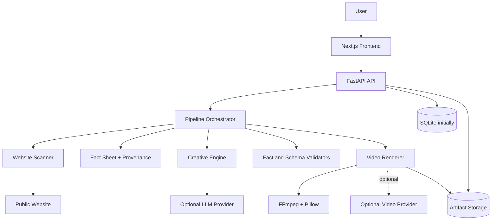

# Architecture — AdForge AI

- Status: Proposed
- Architecture style: Modular monolith with explicit service boundaries
- First deployment: Single instance; production hardening before public access

## 1. System context



## 2. Core modules

### Frontend
Responsibilities:
- Input and form validation for usability.
- Display scan state and facts.
- Allow user correction/approval.
- Collect creative settings.
- Poll or subscribe to job status.
- Preview/download final artifact.
- Render accessible loading, empty, partial, error and success states.

Must not:
- Hold provider API keys.
- Be trusted for security validation.
- Construct arbitrary artifact filesystem paths.
- Treat frontend state as the source of truth for job completion.

### API layer
Responsibilities:
- Parse and validate requests.
- Apply rate/size limits.
- Enforce state transitions and access checks.
- Call orchestration services.
- Return stable error codes and safe messages.
- Serve health/readiness and OpenAPI.

Routes should remain thin. Business logic belongs in services, not route handlers.

### Website scanner
Responsibilities:
- Normalize URL and enforce HTTP/HTTPS only.
- Reject loopback, private, link-local, multicast, reserved and metadata-service destinations.
- Revalidate after DNS resolution and each redirect.
- Bound connection/read timeout, total time, response bytes, page count and crawl depth.
- Extract visible text and candidate assets.
- Return structured extraction plus warnings and provenance.
- Respect robots/access restrictions and never bypass CAPTCHA.

Use HTTPX + BeautifulSoup for ordinary HTML. Add Playwright only when evidence shows client-side rendering is needed. Browser navigation requires stronger network isolation because page scripts can make their own requests.

### Fact model
Represent each extracted value as a value plus provenance:
- `value`
- `source_url`
- `source_kind`: `website`, `user`, `model_suggestion`
- `extraction_method`
- `confidence` or `review_state`
- `observed_at`
- `approved_by_user` / approval timestamp where relevant

Use a precedence policy: user-approved facts > extracted facts. Model-generated suggestions must never silently become verified facts.

### Creative engine
Responsibilities:
- Build a minimal fact sheet.
- Generate structured creative output.
- Validate schema.
- Validate high-risk claims against approved facts.
- Allow one bounded repair attempt if configured.
- Fall back to a deterministic template.
- Version prompts and schemas.

LLM provider access should be hidden behind an interface such as `CreativeProvider.generate(fact_sheet, options)`. Keep provider-specific code out of core orchestration.

### Video renderer
Responsibilities:
- Validate and normalize selected media.
- Create scene timeline.
- Render motion/transition effects.
- Add text using real fonts through Pillow/FFmpeg.
- Optionally add logo, QR, and permitted audio.
- Enforce exact target dimensions and duration constraints.
- Verify output with FFprobe and a playback smoke test.
- Return artifact metadata, warnings and composition details.

Keep phone numbers, addresses, prices and critical CTA overlays as deterministic text. Do not rely on a generative video model to render legible or accurate digits.

### Orchestrator and jobs
Proposed state machine:
`queued -> running -> completed | completed_with_warnings | failed | cancelled`

Track current stage independently:
`scanning`, `fact_review`, `creative`, `rendering`, `validating`.

The initial SQLite/in-process implementation is acceptable only for a single instance and bounded demo load. Use a database transaction for state changes. Store artifacts separately from job metadata. On startup, reconcile stale `running` jobs rather than leaving them indefinitely stuck.

Cancellation should be cooperative. A remote provider call may continue consuming credits after local cancellation; disclose this limitation if applicable.

### Persistence
Initial tables/entities:
- `jobs`
- `business_facts` or a versioned fact-sheet JSON blob
- `creative_outputs`
- `assets`
- `artifacts`
- `job_events` (optional but useful)
- `provider_usage` (when external providers are enabled)

Use repository interfaces so SQLite can later be replaced with Postgres. Avoid a premature ORM choice unless it materially simplifies migrations and tests.

## 3. Suggested repository structure

```text
adforge-ai/
  README.md
  docs/
    README.md
    LLM_CONTEXT.md
    PRD.md
    ARCHITECTURE.md
    API_CONTRACTS.md
    AI_RELIABILITY_EVALUATION.md
    SECURITY.md
    ROADMAP.md
    DECISIONS.md
    DESIGN_SYSTEM.md
    DEPLOYMENT_OPERATIONS.md
    PROGRESS.md
  frontend/
    app/
    components/
    lib/
    public/
  backend/
    app/
      api/
      scraper/
      ai/
      video/
      services/
      store/
      schemas.py
      config.py
      main.py
    tests/
  scripts/
  docker-compose.yml
  .gitignore
  .env.example
```

The documentation pack may initially be stored in a `docs/` folder at the repository root. If it is outside the repo before project creation, copy it into that folder at initialization.

## 4. Key API flow

1. `POST /api/scans` starts a bounded scan and returns a job ID.
2. `GET /api/jobs/{job_id}` reports scan status and result.
3. User edits/approves facts.
4. `POST /api/creatives` generates structured creative output.
5. User reviews/edits creative.
6. `POST /api/ads` starts rendering and returns an ad/job ID.
7. `GET /api/jobs/{job_id}` reports progress.
8. `GET /api/ads/{ad_id}` returns final metadata.
9. `GET /api/ads/{ad_id}/video` streams/downloads the MP4 after authorization checks.

Exact schemas are in `API_CONTRACTS.md`.

## 5. Architectural trade-offs

- **Modular monolith over microservices:** simpler deployment, debugging and testing in a one-week project.
- **SQLite over Postgres initially:** zero-setup local development; migrate if multi-instance/concurrency requirements emerge.
- **FFmpeg renderer as baseline:** reliable, controllable, low-cost output independent of a paid generative video service.
- **Optional provider adapters:** avoid locking core business logic to one model vendor.
- **Human review of facts:** small amount of friction protects against fabricated business details.
- **Polling over WebSockets initially:** sufficient for job progress and easier to deploy. Consider server-sent events later if UX needs it.

## 6. Production evolution path

When the single-instance MVP has measured demand:
1. Add authentication and authorization.
2. Move job execution to a durable worker queue.
3. Move database to Postgres.
4. Store artifacts in object storage with signed, expiring URLs.
5. Add distributed rate limits and per-account quotas.
6. Add structured logs, tracing, metrics and alerting.
7. Add migrations, backups, retention jobs and incident recovery documentation.
